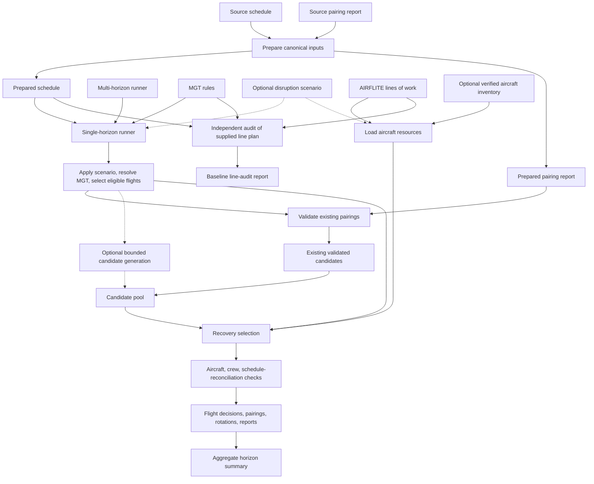

# Codebase map

This document distinguishes the canonical recovery path from older research and compatibility entry points. New solver code belongs under src/crew_recovery/, runnable commands belong under scripts/, tests belong under tests/, and project notes belong under docs/. Do not create duplicate implementations at the repository root.

## Canonical recovery execution

1. setup_workspace.py checks that required files exist under originals/ and invokes scripts/prep_inputs.py.
2. scripts/prep_inputs.py prepares the schedule and pairing report under input/; exact duplicate schedule rows are recorded under output/audit/.
3. scripts/run_joint_recovery_horizons.py invokes scripts/run_one_week_joint_recovery.py for each requested horizon and aggregates the individual summaries.
4. Each single-horizon run resolves MGT, optionally applies a versioned scenario, validates existing pairing-report columns, optionally generates bounded extra pairing candidates, loads aircraft resources, and runs the joint operate/cancel recovery method.
5. Each run performs post-solve aircraft/crew checks and exports decisions, pairings, rotations, validation reports, and a per-flight schedule reconciliation. The schedule reconciliation checks that operated-flight times match the scenario schedule; it is not a full operational-feasibility certificate.
6. scripts/audit_aircraft_line_baseline.py independently audits the supplied AIRFLITE line plan; it does not validate the optimized recovery plan.
7. The workflow in .github/workflows/tests.yml runs preparation, the regression suite, the aircraft-line baseline audit, the three-horizon runner, and artifact upload.

## Current architecture

The one-week horizon uses the joint MILP; larger horizons use the deterministic coverage-first heuristic. The recovery method minimizes cancellations first and then uses the currently supported pairing and aircraft-start cost terms. The model does not optimize retiming, and AIRFLITE `LINE_n` resources are provisional when verified aircraft inventory is absent.

The coverage-LP/master-pricing loop in `integrated_column_generation.py` is a separate research path. It is not invoked by the canonical horizon runner and does not receive dual prices from the joint aircraft-and-crew recovery model. Do not draw it as a connected optimization stage in this current-implementation diagram.

## Reusable implementation: src/crew_recovery/

| Module | Purpose |
|---|---|
| aircraft_inventory.py | Loads and validates explicit aircraft resource inputs when supplied. |
| aircraft_line_audit.py | Reconciles line assignments, station/time transitions, and MGT completeness. |
| aircraft_line_inputs.py | Reads the supplied AIRFLITE lines-of-work input. |
| aircraft_rotation.py | Route/rotation feasibility helpers. |
| crew_costing.py | Computes the currently supported pairing salary basis. |
| independent_validator.py | Active runner's MGTResolver, schedule preparation, and independent crew-pairing legality checks. |
| mgt_effective.py | Separate effective-date MGT resolver utility; not the resolver entry point imported by the active single-horizon runner. |
| objective_spec.py | Legacy four-term objective API retained for compatibility. |
| operational_objective.py | Canonical five-term objective contract and ledger; distinguishes active, partial-proxy, and unintegrated terms. |
| recovery_scenario.py | Strict versioned disruption-event schema and application to flight schedules / aircraft resources. |
| schedule_reconciliation.py | Compares original, scenario-adjusted, and recovered times/equipment; checks output consistency without claiming full operational feasibility. |
| pairing_columns.py | Converts supplied/generated pairing reports to stable candidate columns and validation status. |
| integrated_column_generation.py | Restricted master/pricing research loop; certification is limited to the declared pricing domain. |
| resource_constrained_pricing.py | Enumerates/prices pairings in its bounded duty domain. |
| joint_recovery.py | Joint operate/cancel selection and large-horizon heuristic plan comparison. |
| project_paths.py | Resolves canonical files from originals/ and prepared inputs from input/. |

## Runnable commands: scripts/

| Script | Purpose |
|---|---|
| setup_workspace.py / prep_inputs.py | Validate source presence and create canonical prepared input files. |
| run_joint_recovery_horizons.py | Canonical 1W / 1M / 154D run. |
| run_one_week_joint_recovery.py | Per-horizon operate/cancel selection, post-solve checks, and schedule reconciliation export. |
| audit_aircraft_line_baseline.py | Reconciles original line assignments with the prepared schedule and MGT. |
| audit_full_horizon_readiness.py / audit_recovery_gap.py | Additional readiness and gap audits. |
| run_pairing_experiment.py / run_pairing_experiment_166_days.py | Historical disruption/pairing experiments; not the canonical recovery entry point. |
| revenue_audit.py | Schedule-to-revenue join quality audit; it does not guess a revenue/equipment mapping. |
| objective_layer_readiness.py | Inspects saved coverage-only baselines and reports why the complete objective remains blocked. |

## Tests and automation

The tests/ folder covers pairing legality, MGT effective dates, aircraft resource/route behavior, objective contracts, recovery selection, independent audit logic, pricing, and historical experiment helpers. The GitHub workflow runs the full suite before producing the recovery artifact.

## Canonical files and legacy files

- originals/ is the sole source of truth for provided data/code inputs; identical root-level copies of supplied workbooks/CSVs have been removed.
- input/ contains prepared runtime copies and can be regenerated.
- output/ holds historical committed experiments; the current recovery results are produced under the ignored output/joint_recovery/ path and attached to the CI run as an artifact.
- logs/ retains historical logs for the objective-readiness analysis.
- patches/ contains archived .orig snapshots only; they are not imported as active solver code.
- Root-level launchers and import shims are compatibility surfaces. Add features in scripts/ or src/crew_recovery/, not in duplicate root modules.
- COLUMN_GENERATION_FOUNDATION.md and OBJECTIVE_LAYER_READINESS.md now live under docs/.

## Model boundary

The repository is a tested best-effort crew-pairing and aircraft-line recovery prototype plus an LP-pricing research layer. It is not a production operational crew-recovery optimizer: it does not select retimed flight copies, use verified tail registrations when no approved inventory is provided, implement the complete approved operating-cost/crew-set objective, or prove global optimality for the large-horizon heuristic.
